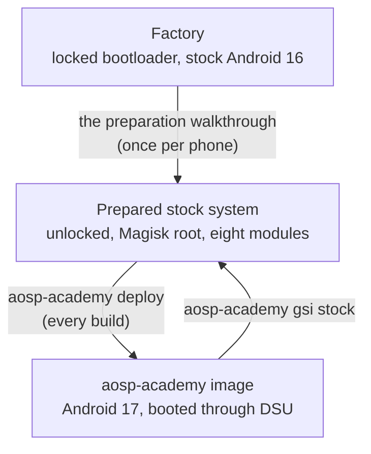

# The device

The phone this project bootstraps and maintains is a **Moto G Power 2026**, hardware model **XT2617V** (the Straight Talk variant sold by Walmart). It is built on a MediaTek **MT6835** system-on-chip. Like every recent Android phone it is split in two halves that meet at a fixed interface (Google calls this **Treble**): a **vendor layer** with the hardware support for this exact phone, which here is an Android 13 vendor layer (VNDK 33, a GKI 5.15 kernel from the `android13-5.15` branch), and a **system** on top of it, which the phone ships as Motorola's Android 16. The [hardware inventory](hardware.md) has the details.

aosp-academy is independent, non-commercial and educational. It is not affiliated with Motorola, Lenovo, Google, MediaTek or any carrier, and it redistributes none of their software. Read the [disclaimer](../reference/disclaimer.md) before you change anything on a phone.

## Three states

The phone goes through three states. Each one is built on the one before and leaves it in place.

1. **Factory.** The bootloader is locked and the phone runs only Motorola's signed build.
2. **The prepared stock system.** The [preparation walkthrough](walkthrough.md) unlocks the bootloader, installs persistent root with Magisk, and turns the phone into a Wi-Fi-only development baseline with eight reversible [Magisk modules](modules.md). The system is still Motorola's Android 16, with nothing on the system partitions changed. This is done once per phone. [The stock system](stock.md) describes the result and how to keep it working.
3. **The aosp-academy image.** The project's own Android 17 system image (`aospacademy_arm64`, built from AOSP on the build node) runs on top of the stock vendor layer through **DSU** (Dynamic System Updates), Android's built-in way to boot a second system from files in `/data`. Nothing is flashed: the slots, the boot images and the stock system stay as they are. [DSU on this phone](dsu.md) explains how that works and how to move between the image and stock; [Deploying an image](../environment/deploying.md) covers the routine `aosp-academy deploy`; [The image](../apps/the-image.md) describes what the image gives an app developer.

The stock system stays Android 16 throughout. Only the image runs Android 17.

## What is persistent and what is reversible

| Change | Where it lives | Undone by |
| --- | --- | --- |
| Unlocked bootloader | `lk_a` and the lock state | **Not undone.** Relocking with a modified boot chain can brick the phone; see [the stock system](stock.md#safe-and-risky). |
| Magisk persistent root | `init_boot_a` | Restoring the original `init_boot_a` from your own backup ([the preparation walkthrough](walkthrough.md) covers the backup and the boot chain). |
| The eight modules | `/data/adb/modules` | Disabling a module and rebooting. A factory reset removes them all. |
| Development-target settings | Android settings and one property | `aosp-academy device settings --reset`. |
| An installed DSU image | `/data/gsi` (the image and its own userdata) | `aosp-academy gsi discard`, from the stock system. |
| A DSU image enabled persistently | DSU's own state | `aosp-academy gsi stock`: the next boot is the stock system again, and the image stays installed. |

Everything in the last four rows lives in `/data` and is reversible. The first two rows are the boot chain. The unlock **erases the phone** when it is done. Preparing the bootloader is the one high-risk step in the whole project: if a bad bootloader stops the phone reaching Fastboot, there is **no vendor-independent recovery proven for this model**. The walkthrough marks that step and explains the risk.

## The tested configuration

The preparation stages are **firmware-specific**. They have been carried out on two units of one exact configuration: XT2617V, Android 16 build `W1WEOS36.48-22-3-3-4-2`, security patch 2026-04-01, active slot `a`. If yours differs, the procedure is not known to work for you, so stop and don't treat it as validated. The full table, both runs and what has *not* been established are in the [validation record](#validation-record) at the end of this page.

## The pages in this section

| Page | What it covers |
| --- | --- |
| [Hardware inventory](hardware.md) | What the phone is: SoC, memory, partitions, display, sensors, HALs, and how to regenerate the record with `aosp-academy device info`. |
| [The preparation walkthrough](walkthrough.md) | The tested procedure from factory to the prepared stock system, with the reason behind every stage. Run once per phone. |
| [The stock system](stock.md) | The prepared stock system as a development baseline: the modules, the development settings, the charge cap, and routine maintenance. |
| [System helpers](helpers.md) | The two small Java programs the preparation runs with `app_process`, and how to write your own. |
| [The Magisk modules](modules.md) | How the eight modules are described, built and verified, and how to write one. |
| [DSU on this phone](dsu.md) | Booting Google's Android 17 GSI or the aosp-academy image through DSU, going back to stock, and what to do when an image doesn't boot. |

The [Android internals](../concepts/index.md) pages explain the background these pages assume: partitions, slots, the boot chain, root and modules.

## Validation record

What was actually tested on the stock side, on which hardware, and what remains unverified. The image builds and the DSU runs on record (Google's GSIs, and the project's own images from the first `aosp_arm64` build onwards) are on the [validation page](../environment/validation.md). The preparation stages are **firmware-specific**: they are known to work only on the configuration below, and only as far as this section says. Read the [disclaimer](../reference/disclaimer.md) too.

### The exact tested device

| Item | Tested value |
| --- | --- |
| Retail model | Moto G Power 2026, Straight Talk, Walmart |
| Hardware model | **XT2617V** |
| Part number | XT2617VSS1PP |
| Box product code | STMXT2617VSSPWP |
| Bootloader product | vegas XT2617V 128 GB PVT (Fastboot reports `vegas`; Android reports `vegas26`) |
| Android | 16 |
| Build | `W1WEOS36.48-22-3-3-4-2` |
| Fingerprint | `motorola/vegas_og_sys/vegas26:16/W1WEOS36.48-22-3-3-4-2/36210f-81d7a:user/release-keys` |
| Security patch | 2026-04-01 |
| Kernel | `5.15.180-android13-8-00018-g9b2308ac0ad6-ab14563692` |
| Bootloader | `MBM-3.1-vegas_og_vext-5d518d-W1WEOS36.48-22-3-3-4-2-36210f` |
| CID | 0x0033 (decimal 51) |
| Active slot | `a` |
| `lk_a` / `init_boot_a` partition sizes | 16 MiB (`0x1000000`) / 8 MiB (`0x800000`) |

**Stop if your phone differs** in model, build, security patch, kernel or active slot. Check with `getprop` (your [first session](../start/first-session.md) shows how) before you start. Don't substitute the Moto G Play, the regular Moto G, the Power 2025, a retail XT2617-1, or any other firmware build. A tool recognising a kernel family, or a verifier reporting `VALID` for a file, is not proof that your phone will accept or boot that file. Newer patches can close the vulnerabilities the procedure depends on.

### Runs on record

The preparation has been carried out twice, on two units of the configuration above, with the same pinned tool versions. These are the recorded outcomes; the procedure itself is the [preparation walkthrough](walkthrough.md).

| | Unit 1 | Unit 2 |
| --- | --- | --- |
| Date | 2026-11-14 | 2026-11-16 |
| Carried out by | parsimo2010, the procedure's original author ([credits](../reference/credits.md)) | this project, following the walkthrough |
| Update staged before the unlock | Yes: current slot A, next boot B, `UPDATED_NEED_REBOOT`. Cancelled with `UpdateHelper`; both slots then reported 0 | No: both slots 0, engine log showed nothing to merge |
| Factory `init_boot_a` SHA-256 | `31239df6b54fd815912ba7d0e4cc87aca3af200eed8ff315238e4178580285ea` | identical |
| Backups | 18 partition images, device and PC hashes matched | same |
| LK analysis | AArch64; payload 1,238,664 bytes; unlock flow, FRP/OEM checker, key validator, erase-permission checks, partition erase ops and runtime serial getter all found | identical |
| Patched LK | verifier `Result: VALID`; other subimages' payloads and certificates unchanged | same |
| Prepared Magisk image SHA-256 | `fbac252d15501e8350b65ae93a92962f93d2907144286c04abf2eeda26c246d0` | identical, byte for byte |
| Patched LK on slot A | booted; Fastboot returned (briefly enumerated as a MediaTek serial device first) | booted; Fastboot returned in about 9 s |
| Unlock | `Bootloader is unlocked!`; `securestate: flashing_unlocked` | same |
| Writing `init_boot_a` from Fastboot | rejected, "Preflash validation failed"; fastbootd could not open `init_boot_a` | not attempted; written from rooted Android as documented |
| Magisk write | read-back hash matched | same |
| Magisk Shell grant | granted through the app's prompt | prompt never appeared (`su: request rejected (2000)`); granted manually from the Superuser tab, as the walkthrough describes |
| Persistent root | `uid=0`, `u:r:magisk:s0`, `31.1:MAGISK:R`, no KernelSU daemon, across multiple full reboots | same, across five reboots |
| Modules | `wifi_ota_guard`, `wifi_carrier_debloat` | the same two plus `wifi_extra_debloat` (19 more packages) |
| Afterwards | Google sign-in, Play Store and Wi-Fi internet worked; DFRoot and KernelSU removed | same |

Both runs retained stock Motorola Android: no custom ROM, no cellular network unlock, no root-hiding or Play Integrity bypass, and no claim of a performance change.

### What has not been established

- Any other model, build, security patch, kernel or slot configuration.
- Guaranteed emergency recovery if the modified LK fails before Fastboot starts. No vendor-independent recovery method was established or tested for this model.
- Restoring a stock boot-chain image after a boot failure. Restoring your own backups from Fastboot is the intended path, but neither run needed it, so it is untested.
- A full OS backup, or a reliable fallback OS on slot B (particularly after a staged update was cancelled there).
- Cellular service, SIM unlock, or carrier features after the carrier debloat.
- Defeat of every undocumented hardware or firmware restriction, including modem or trusted-execution-environment behaviour.
- Universal app or game compatibility, Play Integrity results, or any speed difference.
- Behaviour across future Motorola OTAs, Google Play system updates, Magisk upgrades, or a factory reset (which removes the modules and root grants; see [routine maintenance](stock.md#routine-maintenance)).

### Known problems in the procedure, and what works

| Problem | What worked |
| --- | --- |
| Test DPC's settings UI crashed (both units) | Its ADB service interface cleared device ownership cleanly |
| Turning Wi-Fi off and disabling Smart updates did not stop an already-downloaded OTA from staging (unit 1) | `UpdateEngine.resetStatus()` via `UpdateHelper`, with `misc` temporarily writable |
| `UpdateEngine` reset fails while `misc` is read-only (unit 1) | DFRoot makes `misc` read-only; `blockdev --setrw` for that one partition |
| Ordinary `pm disable` / clear-data on the updater was rejected as a protected operation even as root | The `wifi_ota_guard` overlay module |
| Fastboot rejected the Magisk image; fastbootd did not expose `init_boot` (unit 1) | Writing the verified image from rooted Android, with read-back |
| Magisk never showed the Grant prompt; `su` from ADB was denied instantly (unit 2) | Motorola's background freezer was suspending the Magisk app. Granting Shell manually from the Superuser tab (**+**) stored the policy |
| `pm uninstall --user 0` refused two packages as "non-disable" (unit 2) | Left alone deliberately (`com.amazon.appmanager` ships disabled; `com.motorola.ccc.devicemanagement` is protected) rather than forced through an overlay |

### Stock-system tooling (unit 2)

On unit 2's stock system, all reversible, as described in [The stock system](stock.md).

| Item | Result |
| --- | --- |
| `dev_debuggable` module 1.3 (`ro.debuggable=1`, `ro.build.type=userdebug`) | Clean boot, no crashes, Play Store and launcher unaffected. A Perfetto Java heap dump of Settings, a non-debuggable app, works (a 24 MB dump); stock refuses it (`not profileable` in logcat), and so does `ro.debuggable=1` alone: `ro.build.type` is the property Perfetto checks. Not changed by either property: no JDWP for non-debuggable apps (only `adbd` on `@jdwp-control`), `run-as` still per-app, and `adb root` makes `adbd` abort (SIGABRT) and restart as `shell`. The module's `sepolicy.rule` lets `system_app` set `logd.logpersistd` (user SELinux policy denies it, and Developer options crashes on open without the rule), and its `service.sh` re-applies `persist.logd.size` after boot, giving 16 MiB buffers (with only the property set they come up at 256 KiB). |
| `dev_adb_tcp` module | `adbd` listens on `*:5555` after boot. A Wi-Fi connection from the PC hasn't been exercised: the PC and phone sit on different subnets, which `aosp-academy adb-wifi` detects and reports. |
| F-Droid 2.0.3 (hash-pinned; signing certificate and PGP signature verified against f-droid.org) | Installed over ADB (`versionCode` 2000053, installer none); launches. |
| `google_debloat` module 1.1 (27 Google packages hidden; 8 Play updates removed first with `pm uninstall-system-updates`) | After a reboot none of the 27 packages is listed; Play services, GSF, WebView, Gboard, Contacts, Messages, Files and F-Droid remain, and the Play Store resolves to the factory `/product/priv-app/Phonesky` copy. No crash in the crash log, launcher and root unaffected. |
| `vendor_extras_debloat` module (58 carrier, partner, Motorola and telemetry packages hidden) | After a reboot none of the 58 is listed (only two Battery Care resource overlays remain, which are not apps); camera, launcher, face unlock, Dolby, Moto Secure core, Play services and F-Droid remain, no crash in the crash log, root unaffected. |
| Frida 17.27.4 | `aosp-academy device frida start` pushes and starts the server; `frida-ps -Ua` lists the running apps. |
| Perfetto | `aosp-academy device trace` records and pulls traces. The config file must live in `/data/misc/perfetto-configs/`; `/data/local/tmp` is refused by SELinux. |
| simpleperf | Unusable on this phone: no perf events (`cpu-cycles` and `cpu-clock` both "not supported on the device"). |
| Android Virtualization Framework | Absent: no `ro.boot.hypervisor.*`, no `/dev/kvm`, no `com.android.virt` APEX, no Terminal app. |
| SDK `adb` and pinned `adb` | The same version (37.0.3), so Android Studio and the project's shell share one server; `aosp-academy check` enforces equality. |

### About the committed artifacts

The helper DEX files and the module ZIPs in `stock/` are rebuilt by this project from the sources beside them, and `aosp-academy stock build` verifies that they reproduce ([helpers](helpers.md), [modules](modules.md)). Relative to the files that ran on unit 1:

- **Helpers** (`UpdateHelper.dex`, `UpdaterCleanup.dex`): the Java logic is unchanged; the sources gained documentation comments, which shifts the debug line-number tables in the DEX but not the bytecode that executes.
- **Modules**: each ZIP contains the same `module.prop` and the same set of `.replace` markers, built deterministically from a manifest (fixed entry order and timestamps) and carrying that manifest as `manifest.json`, which Magisk ignores.

### Reporting a result

If you share results, include the model, build, security patch, kernel, the stage, and the exact error text, and **redact** serial numbers, IMEIs, account names, network identifiers and unlock keys. Never attach your backup images or raw logs. A success on another build is a new compatibility result to report, not something to assume from this one.
